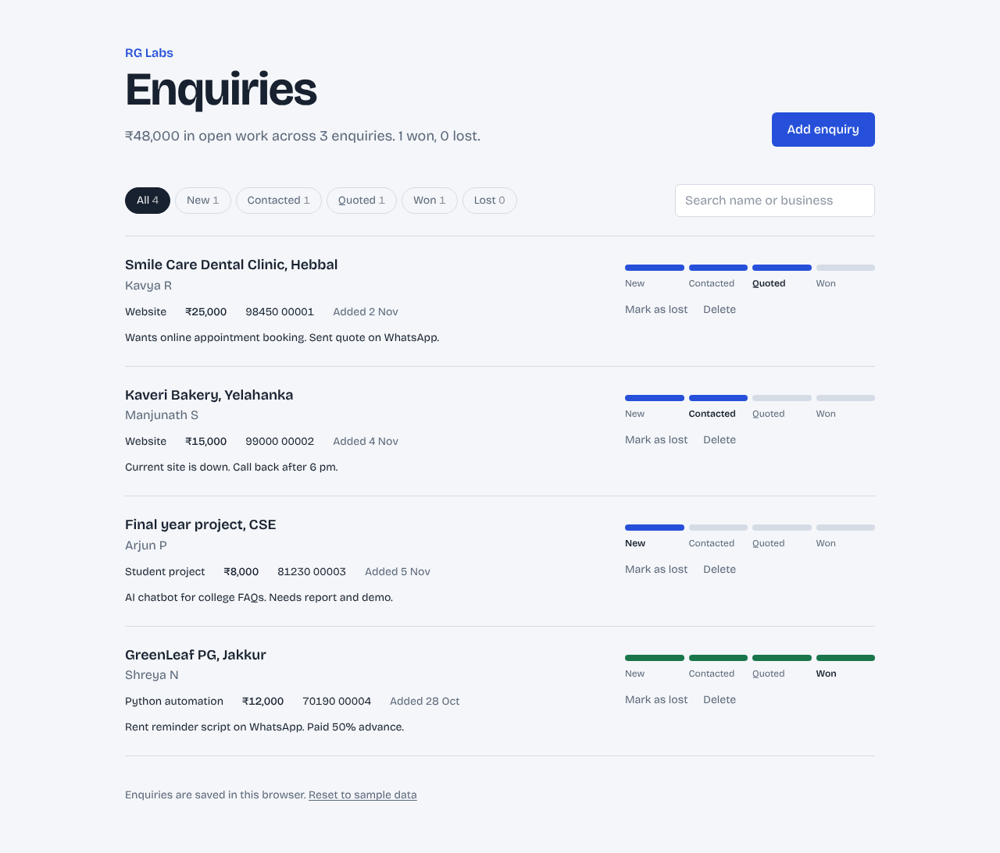

# RG Labs Enquiry Tracker

A small web app I use to track client enquiries for RG Labs, my web design and AI services business, from the first message to a won project.



**Live demo:** https://rg-labs-enquiries.netlify.app

## What it does

- Add an enquiry with the contact, business, mobile number, service, budget and notes, with form validation
- Move each enquiry along its stage track (New, Contacted, Quoted, Won) with one click, or mark it as lost and reopen it later
- Filter by stage and search by name or business
- See the total value of open work at the top of the page
- Data is saved in the browser with `localStorage`, so it survives a page refresh
- Works on mobile and supports dark mode

## Tech stack

- **Next.js 16** (App Router) with **React 19** and **TypeScript**
- **Tailwind CSS** for styling
- **Vitest** for unit tests
- Deployed as a static site on **Netlify**

## How the code is organised

```
app/
  page.tsx            Loads the tracker in the browser only (it needs localStorage)
  layout.tsx          Page shell, title and font
  globals.css         Colour tokens for light and dark mode
components/
  EnquiryTracker.tsx  Main screen: holds the state, filters and summary
  EnquiryForm.tsx     Controlled form with validation
  EnquiryRow.tsx      One enquiry in the list
  StageTrack.tsx      The clickable New → Won progress track
lib/
  types.ts            TypeScript types for an enquiry and the form
  enquiries.ts        Pure functions: validate, create, filter, summarise
  enquiries.test.ts   Unit tests for those functions
  storage.ts          Read and write localStorage safely
docs/
  schema.sql          Planned PostgreSQL table and queries
```

The business logic lives in `lib/enquiries.ts` as plain functions with no React code, which keeps the components simple and makes the logic easy to test.

## Run it locally

You need Node.js 22.12 or newer.

```bash
npm install
npm run dev      # open http://localhost:3000
npm test         # run the unit tests
npm run build    # build the static site into the out/ folder
```

## Built with AI tools

I built this with Claude as my coding assistant. I planned the features, reviewed every change, ran the tests and checked the app in the browser on desktop and mobile before shipping.

## What's next

- Move storage from the browser to a PostgreSQL database (Supabase), using the schema in `docs/schema.sql`
- Add login so only I can see the enquiries
- Send a WhatsApp follow-up reminder for enquiries stuck in one stage
